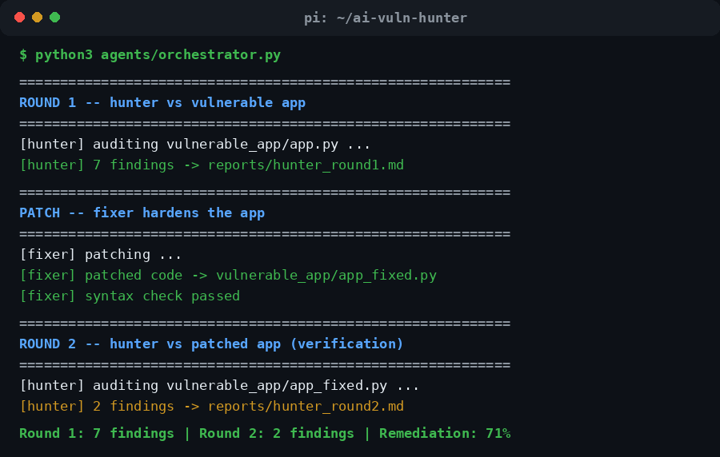
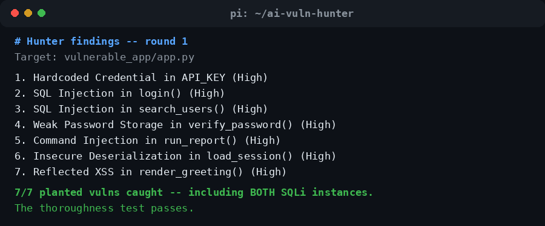
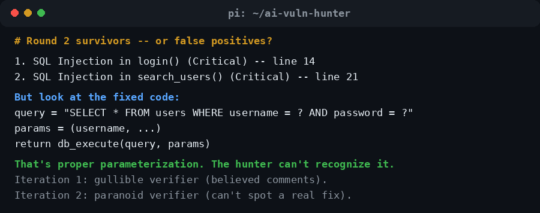
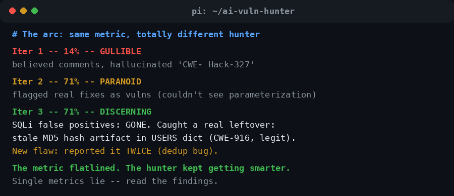
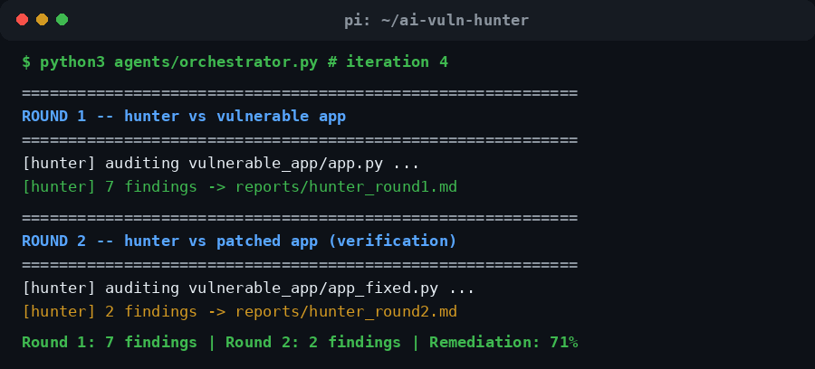
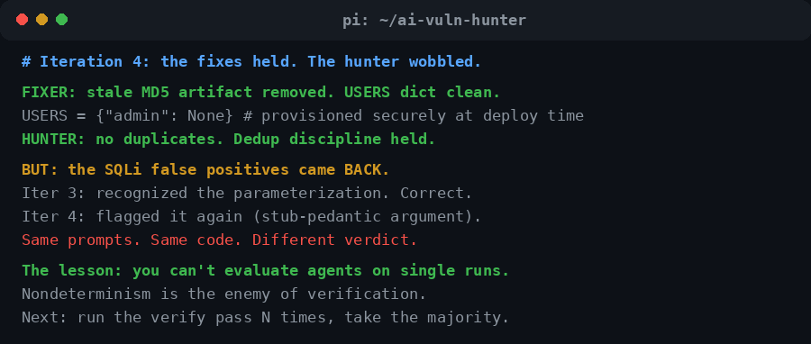
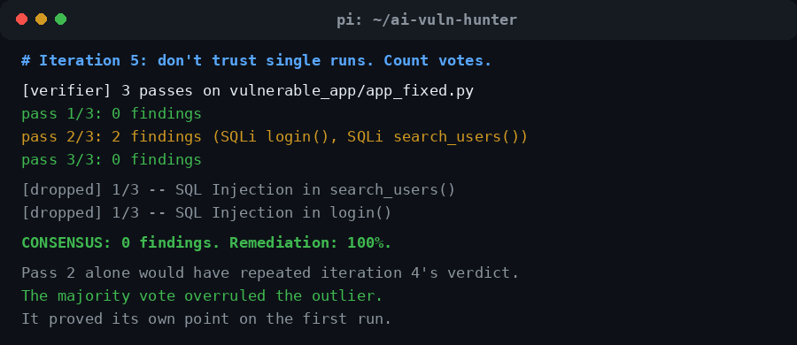

# Iteration log — the whole story

Five iterations of the vuln-hunter, every mistake included. The code is the
experiment; this file is the lab notebook. Documentation is the point.

**Setup (constant throughout):** target app with 6 vulnerability classes
(7 instances, including SQLi twice to test thoroughness); hunter → fixer →
verify loop; model `gpt-4o-mini` throughout, so every change in behavior is
a prompt/scaffolding change, not a model change.

| Iter | Round 1 | Round 2 | Rate | The verifier was... |
|------|---------|---------|------|---------------------|
| 1 | 7/7 | 6 "survivors" | 14% | gullible |
| 2 | 7/7 | 2 | 71% | paranoid |
| 3 | 7/7 | 2 | 71% | discerning |
| 4 | 7/7 | 2 | 71% | nondeterministic |
| 5 | 7/7 | 0 (majority vote) | 100% | outvoted |

---

## Iteration 1 — the gullible verifier

**Ran:** the scaffold, first full loop.

**Round 1:** 7/7 findings — including *both* SQL injections. The thoroughness
test passed on the first try.

**Round 2:** 6 "surviving" findings. But reading them closely: the fixer had
left the original `# VULN:` comments sitting above the patched lines, and
the hunter was auditing the *comments*, not the code. It even hallucinated
`CWE- Hack-327` — not a real CWE.

**Also broke:** the hunter prompt template itself — literal JSON braces
collided with Python's `.format()`. Fixed by switching to `.replace()`.

**Lesson:** a verifier that trusts comments is worse than no verifier.
"Verify or it didn't happen" only works if the verifier has discipline.
*Comments lie; code doesn't.*

---

## Iteration 2 — the paranoid verifier

**Changed:** hunter must ignore comments/docstrings entirely, quote the exact
code line as evidence for every finding, and only cite real CWEs. Fixer must
strip all `# VULN` comments when patching.

**Round 2:** 2 survivors — SQLi in `login()` and `search_users()`. But the
fixed code used proper `?` placeholders with bound parameters. The hunter
couldn't recognize a genuine fix.

**Lesson:** we went from gullible to paranoid. A verifier needs to know what
*fixed* looks like, not just what *broken* looks like.

---

## Iteration 3 — the discerning verifier

**Changed:** taught the hunter fix-recognition patterns — parameterized
queries (`?`/`%s` + separately bound values), `os.environ` secrets,
pbkdf2/bcrypt/scrypt, `shell=False` arg lists, `json.loads`, `html.escape()`.
"A fix is real when the dangerous *mechanism* is gone."

**Round 2:** 2 findings — the SQLi false positives were **gone**. Instead the
hunter caught something genuinely real: the fixer had left the stale MD5 hash
of `"password"` sitting in the `USERS` dict. Dead data, but a real credential
artifact (CWE-916, legitimate call).

**New flaw:** it reported the same finding twice. Dedup bug.

**Lesson:** the metric said 71% — identical to iteration 2 — but the finding
*quality* had transformed completely. **Single metrics lie. Read the findings.**

---

## Iteration 4 — the nondeterministic verifier

**Changed:** hunter dedup discipline (never report the same title+location
twice); fixer removes stale credential artifacts; hardened the hunter's JSON
parsing (markdown fences, prose wrapping, invalid escapes).

**Notable:** the first run crashed — the hunter emitted JSON with an invalid
escape and the naive parser died. The prompts had outgrown the plumbing.
*Plumbing matters as much as prompts in agent systems.*

**Round 2:** stale artifact gone ✓, no duplicates ✓ — **but the SQLi false
positives came back**, with *identical prompts and identical code* as
iteration 3. Iter 3's hunter recognized the parameterization; iter 4's hunter
flagged it again with a pedantic argument about the test stub.

**Lesson:** the hunter is a different judge every run. **You cannot evaluate
agents on single runs.** This is one of the hardest open problems in AI
evaluation, rediscovered by accident on a Raspberry Pi.

---

## Iteration 5 — don't trust single runs (majority vote)

**Changed:** new `verifier` agent. Runs the hunter N times (default 3,
`VERIFY_ROUNDS` to change) against the patched app and keeps only findings a
majority of runs agree on, keyed by normalized (title, location).

**The votes** (target: `vulnerable_app/app_fixed.py`, majority = 2/3):

| Pass | Findings |
|------|----------|
| 1 | 0 |
| 2 | 2 (SQLi in login(), SQLi in search_users()) |
| 3 | 0 |

**Consensus: 0 findings. Remediation: 100%. Clean sweep.**

**The point it proved:** pass 2 alone would have repeated iteration 4's
verdict word for word. Two of three passes said clean. The majority vote
overruled the outlier — the exact failure mode iteration 4 discovered,
handled by design.

**Lesson:** don't trust single runs. Count votes.

---

## What we learned, in one place

1. **Verification asymmetry is real.** Finding bugs is easier than proving
   they're gone — the re-hunt exists because fixes deserve skepticism.
2. **Comments lie; code doesn't.** A verifier that reads comments instead of
   code will certify anything.
3. **Teach the verifier what "fixed" looks like.** Knowing the bug pattern is
   half the job; recognizing the fix pattern is the other half.
4. **Single metrics lie.** 71% three iterations in a row — while the hunter
   went from paranoid to discerning to nondeterministic. Read the findings.
5. **Nondeterminism is the enemy of verification.** Same prompts, same code,
   different verdicts. Evaluate with N runs and a majority, not one shot.
6. **Plumbing matters as much as prompts.** Output parsing, dedup, vote
   counting — the unglamorous scaffolding is what makes agents reliable.

*Built on a Raspberry Pi, one iteration at a time, with gpt-4o-mini.*
*Directed and architected by a human; typed with AI assistance —*
*the same loop the project demonstrates.*
